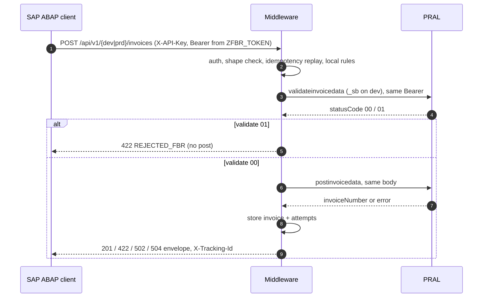

# FBR Middleware: SAP Interface Specification for ABAP

As of 2026-10-14. Living copy with comments: https://claude.ai/code/artifact/3c687f3f-f1fd-4db9-88ea-b539ef24d705.
Word export: `docs/SAP-ABAP-Interface-Spec.docx`.

## 1. Overview

SAP sends one HTTP POST per invoice and gets PRAL's answer back in the same response. The middleware checks the headers and the payload shape, replays a result it already holds, runs the local business rules, calls PRAL `validateinvoicedata` and then `postinvoicedata` with the Bearer token SAP supplied, stores the outcome and returns PRAL's body verbatim inside a thin envelope. There is no queue, callback, OData service or polling.

One middleware instance serves both PRAL environments. The URL segment chooses it: `dev` is the PRAL sandbox (`..._sb` endpoints, `scenarioId` required) and `prd` is production (plain endpoints, `scenarioId` stripped). SAP stays the system of record for the FBR invoice number; the middleware keeps an audit trail of every PRAL call and an idempotency store keyed on `erpInvoiceNo` within each environment.



A validate rejection stops before post; a post answer, timeout or auth failure each map to one `status` and one HTTP code in section 6.

## 2. Endpoints, method and headers

SAP calls the middleware, never PRAL. The host and port come from the SM59 destination: middleware server `10.0.0.86`, port `8080` (plain HTTP during development; HTTPS on 443 once TLS is set up on the server). Only the path differs per environment. Example: `http://10.0.0.86:8080/api/v1/dev/invoices`.

| Method | Path | Headers | Purpose |
| --- | --- | --- | --- |
| POST | `/api/v1/dev/invoices` | `X-API-Key`, `Authorization: Bearer <sandbox token>`, `Content-Type: application/json` | Submit to PRAL sandbox during certification |
| POST | `/api/v1/prd/invoices` | `X-API-Key`, `Authorization: Bearer <production token>`, `Content-Type: application/json` | Submit to PRAL production |
| POST | `/api/v1/dev/invoices/validate` | same as the submit call | Dry run: local rules + PRAL `validateinvoicedata` only. Nothing is posted, no FBR number, nothing stored |
| POST | `/api/v1/prd/invoices/validate` | same as the submit call | Dry run against production validation, same guarantees |
| GET | `/api/v1/dev/invoices/{erpInvoiceNo}` | `X-API-Key` | Stored result of an earlier sandbox submission |
| GET | `/api/v1/prd/invoices/{erpInvoiceNo}` | `X-API-Key` | Stored result of an earlier production submission; call it after a 504 or an ABAP-side timeout before resubmitting |
| GET | `/health` | none | Liveness; useful from SM59 connection test |

Headers on the POST:

| Header | Value | Source in SAP | Missing or wrong |
| --- | --- | --- | --- |
| `X-API-Key` | key issued by the middleware team, one per SAP system (DEV, QAS, PRD) | SM59 destination header or a constant in the client class | HTTP 401, nothing stored |
| `Authorization` | `Bearer <PRAL token>` for the environment of the path | `ZFBR_TOKEN` read by `SELLER_NTN` and `ENV` (`SB` for dev, `PROD` for prd) | HTTP 401 if absent or not `Bearer <token>`; HTTP 502 `AUTH_ERROR` if PRAL rejects it |
| `Content-Type` | `application/json` | set by the client class | HTTP 422 |
| `Accept` | `application/json` | optional | |

The same `ENV` key that selects the token selects the path segment, so a token and a path can never be mixed. Any other segment, for example `/api/v1/qa/invoices`, answers HTTP 404.

The validate call takes the same body as the submit call and answers with the same envelope. Use it to pre-check a billing document on save or during certification without consuming an FBR number; a later submit with the same `erpInvoiceNo` is processed normally, not replayed.

## 3. Request parameters

The body is a JSON envelope around the PRAL payload. Every field below is checked before anything is stored; a violation returns HTTP 422 naming the field. Unknown keys are rejected, so send exactly these names, case-sensitive.

### 3.1 Envelope

| Field | Type | Required | Rule |
| --- | --- | --- | --- |
| `erpInvoiceNo` | string, 1 to 50 chars | required | SAP billing document number (`VBRK-VBELN`). Idempotency key within the environment: the same value again returns the stored result, HTTP 200, `replayed: true`. |
| `sellerNtn` | string | required | 7-digit NTN or 13-digit CNIC of the issuing company. Must equal `invoice.sellerNTNCNIC`. |
| `callbackRef` | string, up to 100 chars | optional | Echoed back unchanged. Suggested: company code + fiscal year, e.g. `1000/2025`. |
| `invoice` | object | required | The PRAL payload (3.2 and 3.3). |

### 3.2 `invoice` header

| Field | Type | Required | Rule |
| --- | --- | --- | --- |
| `invoiceType` | string | required | `Sale Invoice` or `Debit Note`, exact spelling |
| `invoiceDate` | string | required | `YYYY-MM-DD`, not after today (Pakistan date) |
| `sellerNTNCNIC` | string | required | 7 or 13 digits, no dashes |
| `sellerBusinessName` | string | required | non-blank |
| `sellerProvince` | string | required | PRAL province description, e.g. `Sindh`, `Punjab`, `Khyber Pakhtunkhwa`, `Balochistan`, `Islamabad Capital Territory` |
| `sellerAddress` | string | required | non-blank |
| `buyerRegistrationType` | string | required | `Registered` or `Unregistered` |
| `buyerNTNCNIC` | string | conditional | required when `Registered`; 7 or 13 digits; must differ from `sellerNTNCNIC`. Optional for `Unregistered`; send `""` when absent. |
| `buyerBusinessName` | string | required | non-blank |
| `buyerProvince` | string | required | PRAL province description |
| `buyerAddress` | string | required | non-blank |
| `invoiceRefNo` | string | conditional | `Debit Note`: the FBR invoice number of the original sale invoice (22 chars for NTN sellers, 28 for CNIC sellers). `Sale Invoice`: must be `""`. |
| `scenarioId` | string | conditional | `SN001` to `SN028`. Required on the `dev` path; may be omitted on `prd`, where the middleware strips it anyway. |
| `items` | array | required | at least one item |

### 3.3 `invoice.items[]`

| Field | Type | Required | Rule |
| --- | --- | --- | --- |
| `hsCode` | string | required | `dddd.dddd`, e.g. `0101.2100` |
| `productDescription` | string | required | non-blank |
| `rate` | string | required | PRAL rate description, e.g. `18%`, `Exempt`, `0%` |
| `uoM` | string | required | PRAL UOM description, e.g. `Numbers, pieces, units`, `KG` |
| `saleType` | string | required | PRAL transaction type description, e.g. `Goods at standard rate (default)` |
| `quantity` | number | required | greater than 0, up to 4 decimals |
| `totalValues` | number | required | 0 or more, 2 decimals. Total including tax |
| `valueSalesExcludingST` | number | required | 0 or more, 2 decimals |
| `fixedNotifiedValueOrRetailPrice` | number | required | 0 or more, 2 decimals; `0.00` when not a 3rd Schedule item |
| `salesTaxApplicable` | number | required | 0 or more, 2 decimals |
| `salesTaxWithheldAtSource` | number | required | 0 or more, 2 decimals; must be `0` or equal to `salesTaxApplicable` |
| `extraTax` | number | optional | default `0.00` |
| `furtherTax` | number | optional | default `0.00` |
| `fedPayable` | number | optional | default `0.00` |
| `discount` | number | optional | default `0.00` |
| `sroScheduleNo` | string | optional | default `""`; PRAL requires it for SRO-based sale types (its error 0077) |
| `sroItemSerialNo` | string | optional | default `""`; PRAL requires it for SRO-based sale types (its error 0078) |

Numbers are JSON numbers, not quoted strings. Optional fields may be omitted; the middleware always forwards them to PRAL with their defaults.

## 4. Sample payloads

These are the PRAL spec v1.12 samples wrapped in the envelope. They pass the middleware's checks as they stand and are the bodies in the Postman collection `postman/FBR-Middleware.postman_collection.json`. JSON files: `docs/samples/`.

### 4.1 Sale invoice, `POST /api/v1/dev/invoices`

```json
{
  "erpInvoiceNo": "0090000001",
  "sellerNtn": "0786909",
  "callbackRef": "1000/2025",
  "invoice": {
    "invoiceType": "Sale Invoice",
    "invoiceDate": "2025-04-21",
    "sellerNTNCNIC": "0786909",
    "sellerBusinessName": "Company 8",
    "sellerProvince": "Sindh",
    "sellerAddress": "Karachi",
    "buyerNTNCNIC": "1000000000000",
    "buyerBusinessName": "FERTILIZER MANUFAC IRS NEW",
    "buyerProvince": "Sindh",
    "buyerAddress": "Karachi",
    "buyerRegistrationType": "Registered",
    "invoiceRefNo": "",
    "scenarioId": "SN001",
    "items": [
      {
        "hsCode": "0101.2100",
        "productDescription": "product Description",
        "rate": "18%",
        "uoM": "Numbers, pieces, units",
        "quantity": 1.0000,
        "totalValues": 0.00,
        "valueSalesExcludingST": 1000.00,
        "fixedNotifiedValueOrRetailPrice": 0.00,
        "salesTaxApplicable": 180.00,
        "salesTaxWithheldAtSource": 0.00,
        "extraTax": 0.00,
        "furtherTax": 120.00,
        "sroScheduleNo": "",
        "fedPayable": 0.00,
        "discount": 0.00,
        "saleType": "Goods at standard rate (default)",
        "sroItemSerialNo": ""
      }
    ]
  }
}
```

### 4.2 Production variant, `POST /api/v1/prd/invoices`

Same body with these differences: no `scenarioId` key (or any value, it is stripped), `buyerRegistrationType: "Unregistered"` with `buyerNTNCNIC: ""` for a walk-in buyer, and `sroScheduleNo` filled only for SRO-based sale types. The production Bearer token goes in the header.

### 4.3 Debit note, `POST /api/v1/dev/invoices`

```json
{
  "erpInvoiceNo": "0090000002",
  "sellerNtn": "0786909",
  "callbackRef": "1000/2025",
  "invoice": {
    "invoiceType": "Debit Note",
    "invoiceDate": "2025-05-20",
    "sellerNTNCNIC": "0786909",
    "sellerBusinessName": "Company 8",
    "sellerProvince": "Sindh",
    "sellerAddress": "Karachi",
    "buyerNTNCNIC": "1000000000000",
    "buyerBusinessName": "FERTILIZER MANUFAC IRS NEW",
    "buyerProvince": "Sindh",
    "buyerAddress": "Karachi",
    "buyerRegistrationType": "Registered",
    "invoiceRefNo": "7000007DI1747119701593",
    "scenarioId": "SN001",
    "items": [
      {
        "hsCode": "0101.2100",
        "productDescription": "price adjustment on original invoice",
        "rate": "18%",
        "uoM": "Numbers, pieces, units",
        "quantity": 1.0000,
        "totalValues": 236.00,
        "valueSalesExcludingST": 200.00,
        "fixedNotifiedValueOrRetailPrice": 0.00,
        "salesTaxApplicable": 36.00,
        "salesTaxWithheldAtSource": 0.00,
        "extraTax": 0.00,
        "furtherTax": 0.00,
        "sroScheduleNo": "",
        "fedPayable": 0.00,
        "discount": 0.00,
        "saleType": "Goods at standard rate (default)",
        "sroItemSerialNo": ""
      }
    ]
  }
}
```

`invoiceRefNo` is the `fbrInvoiceNo` the middleware returned for the original sale invoice, read from the SAP link table (section 8). PRAL rejects a note dated before the original or more than 180 days after it.

## 5. Payload mapping: SAP source for each field

The billing document (`VBRK` / `VBRP`) is the source; master data supplies the parties, and four small Z mapping tables turn SAP codes into the description strings PRAL expects. Standard-table sources are proposals from the SD data model; the Z tables and the condition types are to be confirmed by the SAP functional consultant before the mapping is frozen. All amounts are in document currency and must be PKR.

### 5.1 Envelope and header

| Field | SAP source | Transformation |
| --- | --- | --- |
| `erpInvoiceNo` | `VBRK-VBELN` | as is, leading zeros kept |
| `sellerNtn` | `ZFBR_SELLER-NTN` by `VBRK-BUKRS` | 7 or 13 digits, no dashes |
| `callbackRef` | `VBRK-BUKRS` + `/` + `VBRK-GJAHR` | free text, up to 100 chars |
| `invoiceType` | `VBRK-VBTYP` | `M` (invoice) = `Sale Invoice`; `P` (debit memo) = `Debit Note`; credit memos (`O`) are out of scope until PRAL confirms credit notes |
| `invoiceDate` | `VBRK-FKDAT` | `YYYY-MM-DD` |
| `sellerNTNCNIC` | same as `sellerNtn` | identical value |
| `sellerBusinessName` | `ZFBR_SELLER-NAME` by `BUKRS` (registered name, not `T001-BUTXT` if it differs) | as registered with FBR |
| `sellerProvince` | `ADRC-REGION` of the company address (`T001-ADRNR`) | `ZFBR_PROVINCE`: SAP region code to PRAL description, e.g. `PK-SD` to `Sindh` |
| `sellerAddress` | `ADRC-STREET`, `-CITY1` of the company address | joined with `, ` |
| `buyerRegistrationType` | buyer's `KNA1-STCD1` (NTN) present and FBR status active | `Registered` when an NTN is on file, else `Unregistered`; the STATL check can be added later |
| `buyerNTNCNIC` | `KNA1-STCD1` (NTN) or `KNA1-STCD2` (CNIC) of the sold-to party `VBRK-KUNAG` | digits only; `""` for an unregistered buyer without a number. Confirm sold-to vs bill-to (`VBPA` with `PARVW = RE`) |
| `buyerBusinessName` | `KNA1-NAME1` (+ `NAME2`) | as is |
| `buyerProvince` | `KNA1-REGIO` | `ZFBR_PROVINCE` |
| `buyerAddress` | `KNA1-STRAS`, `KNA1-ORT01` | joined with `, ` |
| `invoiceRefNo` | for `Debit Note`: preceding invoice from `VBFA` (`VBTYP_N = P`, `VBTYP_V = M`), then `ZFBR_LINK-FBR_INVOICE_NO` of that invoice | 22 or 28 chars; `""` for `Sale Invoice`. Block the send if the original has no FBR number |
| `scenarioId` | `ZFBR_SCENARIO` by sale type, sandbox only | `SN001` to `SN028`; omitted on `prd` |

### 5.2 Items (one per `VBRP` row)

| Field | SAP source | Transformation |
| --- | --- | --- |
| `hsCode` | `MARC-STEUC` (commodity / control code) for `VBRP-MATNR`, `VBRP-WERKS`; a `ZFBR_MATHS` override if the plant value is unreliable | first 8 digits formatted `dddd.dddd` |
| `productDescription` | `VBRP-ARKTX` | as is |
| `rate` | `ZFBR_TAXMAP-RATE_DESC` by `VBRP-MWSKZ` (tax code) | PRAL rate description string, e.g. `18%` |
| `saleType` | `ZFBR_TAXMAP-SALE_TYPE` by `VBRP-MWSKZ` (and material tax class `MLAN-TAXM1` where one tax code serves several) | PRAL transaction type description |
| `uoM` | `VBRP-VRKME` | `ZFBR_UOM`: SAP unit (`T006`) to PRAL description, e.g. `ST` to `Numbers, pieces, units`, `KG` to `KG` |
| `quantity` | `VBRP-FKIMG` | decimal, 4 places |
| `valueSalesExcludingST` | `VBRP-NETWR` | 2 places |
| `salesTaxApplicable` | `VBRP-MWSBP`, or condition `MWST` from `PRCD_ELEMENTS` (`KNUMV = VBRK-KNUMV`, `KPOSN = VBRP-POSNR`) | 2 places |
| `totalValues` | `VBRP-NETWR + VBRP-MWSBP` (+ further and extra tax conditions) | 2 places |
| `fixedNotifiedValueOrRetailPrice` | Z pricing condition for retail / notified price (e.g. `ZRTP`), 3rd Schedule goods only | 2 places, else `0.00` |
| `salesTaxWithheldAtSource` | withholding condition (e.g. `ZWHT`) | `0.00` or exactly `salesTaxApplicable` |
| `extraTax` | condition `ZEXT` | 2 places, default `0.00` |
| `furtherTax` | condition `ZFUR` (further tax on unregistered buyers) | 2 places, default `0.00` |
| `fedPayable` | condition `ZFED` | 2 places, default `0.00` |
| `discount` | sum of discount conditions (`K007`, `K005`, `RA01`) | absolute value, 2 places |
| `sroScheduleNo` | `ZFBR_SRO-SCHEDULE_NO` by `MWSKZ` (+ material) | `""` unless the sale type is SRO-based |
| `sroItemSerialNo` | `ZFBR_SRO-ITEM_SERIAL` by `MWSKZ` (+ material) | `""` unless the sale type is SRO-based |

### 5.3 Z mapping tables to create

| Table | Key | Fields | Filled from |
| --- | --- | --- | --- |
| `ZFBR_SELLER` | `BUKRS` | `NTN`, `NAME`, `PROVINCE`, `ADDRESS` | FBR registration of each company code |
| `ZFBR_PROVINCE` | `LAND1`, `REGIO` | `PRAL_DESC` | PRAL reference list 5.1 (provinces) |
| `ZFBR_TAXMAP` | `MWSKZ` (+ `TAXM1`) | `RATE_DESC`, `SALE_TYPE` | PRAL reference lists 5.5 (transaction types) and 5.8 (rates) |
| `ZFBR_UOM` | `MSEHI` | `PRAL_DESC` | PRAL reference list 5.6 (UOM) |
| `ZFBR_SRO` | `MWSKZ`, `MATNR` (optional) | `SCHEDULE_NO`, `ITEM_SERIAL` | PRAL reference lists 5.7 and 5.10 |
| `ZFBR_SCENARIO` | `SALE_TYPE` | `SCENARIO_ID` | spec section 9, sandbox certification only |

The description strings must match PRAL's reference data character for character; a mismatch is a PRAL rejection (error 0046, 0052, 0099), not a warning.

## 6. Expected response

Every processed submission, and every GET, returns the same envelope. The HTTP code and the `status` field say what happened; `pralResponse` is PRAL's body exactly as received, so the per-item FBR numbers and error codes are available without a second call.

### 6.1 Envelope fields

| Field | Type | Present | Meaning |
| --- | --- | --- | --- |
| `trackingId` | string (UUID) | always | middleware correlation id, also in the `X-Tracking-Id` response header; store it for support |
| `environment` | string | always | `dev` or `prd` |
| `erpInvoiceNo` | string | always | echoed |
| `sellerNtn` | string | always | echoed |
| `callbackRef` | string or null | always | echoed |
| `status` | string | always | `SUBMITTED`, `VALIDATED`, `REJECTED_LOCAL`, `REJECTED_FBR`, `FAILED_UPSTREAM`, `AUTH_ERROR`, `UNKNOWN` |
| `replayed` | boolean | always | `true` when the stored result was returned instead of calling PRAL |
| `fbrInvoiceNo` | string or null | on `SUBMITTED` | PRAL `invoiceNumber`, e.g. `0786909DI1791922500470` |
| `dated` | string or null | when PRAL answered | PRAL `dated`, `YYYY-MM-DD HH:MM:SS` |
| `pralHttpStatus` | integer or null | when PRAL answered | HTTP code of the last PRAL call |
| `pralResponse` | object or null | when PRAL answered | PRAL body verbatim; `validationResponse.invoiceStatuses[].invoiceNo` holds the per-item numbers |
| `localErrors` | array | always | `[{field, code, message}]`, filled only for `REJECTED_LOCAL` |
| `errorDescriptions` | array | always | `[{code, description}]`, one per PRAL `errorCode`, text from spec section 7 |
| `attempts` | integer | always | PRAL calls made for this document, cumulative over resubmissions |
| `receivedAt`, `completedAt` | ISO datetime (UTC) | always | |
| `elapsedMs` | integer | always | |

### 6.2 Status to HTTP code and SAP action

| HTTP | `status` | Meaning | SAP action |
| --- | --- | --- | --- |
| 201 | `SUBMITTED` | PRAL issued the number | store `fbrInvoiceNo`, `dated`, per-item `invoiceNo`, `trackingId`; release output |
| 200 | `VALIDATED` | dry-run call only: PRAL validate passed, nothing posted or stored | submit when ready |
| 200 | any, `replayed: true` | the same `erpInvoiceNo` was already final (`SUBMITTED` or `UNKNOWN`) | treat as the stored status; no new PRAL call happened |
| 422 | `REJECTED_LOCAL` | middleware business rule failed | show `localErrors`, fix data, resubmit |
| 422 | `REJECTED_FBR` | PRAL answered `statusCode 01` on the header or an item | show `errorDescriptions` and `pralResponse.validationResponse`, fix data, resubmit |
| 422 | no envelope, `{"detail": [...]}` | payload shape violation, nothing stored | fix the field named in `detail[].field` |
| 401 | no envelope | `X-API-Key` or `Authorization` missing or malformed, nothing stored | fix the headers; check `ZFBR_TOKEN` has a value |
| 404 | no envelope | wrong environment segment, or GET for an unknown `erpInvoiceNo` | |
| 502 | `FAILED_UPSTREAM` | PRAL 5xx after 3 attempts, or unreachable | resubmit later (automatic retry after 10 minutes is safe) |
| 502 | `AUTH_ERROR` | PRAL returned 401 or error 0401 / 0402: token invalid, expired or not bound to this NTN | alert the token owner; update `ZFBR_TOKEN`; resubmit |
| 504 | `UNKNOWN` | post was sent, no answer arrived; PRAL may have issued a number | do **not** resubmit; call GET later; if still `UNKNOWN`, reconcile on the FBR portal |

### 6.3 Success, HTTP 201

```json
{
  "trackingId": "e9895805-4b54-4ec6-8b6a-8311b66fbe08",
  "environment": "dev",
  "erpInvoiceNo": "0090000001",
  "sellerNtn": "0786909",
  "callbackRef": "1000/2025",
  "status": "SUBMITTED",
  "replayed": false,
  "fbrInvoiceNo": "0786909DI1791922500470",
  "dated": "2026-10-14 01:15:00",
  "pralHttpStatus": 200,
  "pralResponse": {
    "invoiceNumber": "0786909DI1791922500470",
    "dated": "2026-10-14 01:15:00",
    "validationResponse": {
      "statusCode": "00",
      "status": "Valid",
      "error": "",
      "invoiceStatuses": [
        { "itemSNo": "1", "statusCode": "00", "status": "Valid",
          "invoiceNo": "0786909DI1791922500470-1", "errorCode": "", "error": "" }
      ]
    }
  },
  "localErrors": [],
  "errorDescriptions": [],
  "attempts": 2,
  "receivedAt": "2026-10-13T20:15:00.016823Z",
  "completedAt": "2026-10-13T20:15:00.062818Z",
  "elapsedMs": 45
}
```

### 6.4 PRAL rejection, HTTP 422

```json
{
  "status": "REJECTED_FBR",
  "fbrInvoiceNo": null,
  "pralHttpStatus": 200,
  "pralResponse": {
    "dated": "2026-10-14 01:16:10",
    "validationResponse": {
      "statusCode": "00",
      "status": "invalid",
      "errorCode": null,
      "error": "",
      "invoiceStatuses": [
        { "itemSNo": "1", "statusCode": "01", "status": "Invalid",
          "invoiceNo": null, "errorCode": "0046", "error": "Provide rate." }
      ]
    }
  },
  "errorDescriptions": [
    { "code": "0046", "description": "Rate cannot be empty, please provide valid rate as per selected Sales Type." }
  ],
  "attempts": 1
}
```

Other envelope fields are present as in 6.3. A header-level rejection has `validationResponse.statusCode: "01"`, its `errorCode` set and `invoiceStatuses: null`. Success in PRAL terms is header `statusCode == "00"` and every item `statusCode == "00"`; the `status` text varies in case and must not be compared.

### 6.5 Shape violation, HTTP 422, nothing stored

```json
{ "detail": [ { "field": "invoice.scenarioId",
                "message": "scenarioId (SN001..SN028) is required for the dev (sandbox) environment",
                "type": "L008" } ] }
```

`field` is the JSON path, e.g. `invoice.items.0.salesTaxWithheldAtSource`.

### 6.6 Header errors, HTTP 401

```json
{ "detail": "Missing Authorization: Bearer header" }
```

## 7. Validations and data formats

The middleware rejects a bad payload before storing anything (HTTP 422 with `detail[].field`), so SAP should apply the same rules before sending and treat a 422 without an envelope as a mapping defect, not a PRAL verdict.

### 7.1 Checked before anything is stored

| Rule | Field named in `detail` |
| --- | --- |
| every required field present, correct JSON type, no unknown keys | the field, or the unknown key |
| `erpInvoiceNo` 1 to 50 chars; `callbackRef` up to 100 | `erpInvoiceNo`, `callbackRef` |
| `sellerNtn` equals `invoice.sellerNTNCNIC` | `sellerNtn` |
| `invoiceType` in {`Sale Invoice`, `Debit Note`}; `buyerRegistrationType` in {`Registered`, `Unregistered`} | the field |
| `invoiceDate` is `YYYY-MM-DD` and not after today | `invoice.invoiceDate` |
| NTN/CNIC values are 7 or 13 digits | `invoice.sellerNTNCNIC`, `invoice.buyerNTNCNIC` |
| `buyerNTNCNIC` present when `Registered`, and different from the seller | `invoice.buyerNTNCNIC` |
| `invoiceRefNo` present and 22 or 28 chars for `Debit Note`; empty for `Sale Invoice` | `invoice.invoiceRefNo` |
| `scenarioId` `SN001` to `SN028`, present on the `dev` path | `invoice.scenarioId` |
| `hsCode` matches `dddd.dddd` | `invoice.items.N.hsCode` |
| `quantity` greater than 0, at most 4 decimals; every amount 0 or more, at most 2 decimals | the item field |
| `salesTaxWithheldAtSource` is 0 or equals `salesTaxApplicable` | `invoice.items.N.salesTaxWithheldAtSource` |
| text fields non-blank; `items` has at least one entry | the field |

### 7.2 Not checked locally, rejected by PRAL instead

Province, rate, UOM and sale type strings against PRAL's reference lists; HS code versus sale type; tax arithmetic (tax equals value times rate, the Rs 20,000 / 5% rule, 3rd Schedule formula); debit-note date window (on or after the original, within 180 days); SRO numbers for SRO-based sale types; STATL status of the buyer. These come back as `REJECTED_FBR` with the PRAL error code and its description.

### 7.3 Formats

| Item | Format |
| --- | --- |
| Dates | `YYYY-MM-DD` as a JSON string, e.g. `2025-04-21` (convert `FKDAT`; never DD.MM.YYYY) |
| Amounts | JSON numbers, 2 decimals, dot as decimal separator, no thousands separator, never negative, never quoted: `1000.00` |
| Quantity | JSON number, up to 4 decimals: `1.0000` |
| NTN / CNIC | digits only as a string: `"0786909"`, `"1000000000000"`; keep leading zeros |
| Empty optional strings | `""`, not `null` and not omitted inside the item unless the default applies |
| Encoding | UTF-8, `Content-Type: application/json` |
| Field names | exactly as listed, case-sensitive: `sellerNTNCNIC`, `uoM`, `valueSalesExcludingST` |

### 7.4 Idempotency and resubmission

- One `erpInvoiceNo` per environment is processed once. A second POST with the same number returns the stored result with HTTP 200 and `replayed: true` when it ended `SUBMITTED` or `UNKNOWN`. PRAL is not called again.
- A document that ended `REJECTED_LOCAL`, `REJECTED_FBR`, `FAILED_UPSTREAM` or `AUTH_ERROR` is processed again on the next POST with the same number, with the corrected data. The new result carries a new `trackingId`.
- The same `erpInvoiceNo` on `dev` and on `prd` are independent records.
- A PRAL rejection is a data error: resending the same payload fails the same way. Correct the mapping or the master data first.
- The validate call never stores anything, so it never influences replay.

### 7.5 Timing

Worst case per submission is two PRAL calls with up to three attempts each at 30 s plus backoff, about 200 s. Set the ABAP HTTP client timeout to at least 200 s and never treat a client-side timeout as a failure: call the GET first.

## 8. SAP prerequisites and ABAP implementation notes

### 8.1 Basis and configuration

| Item | Detail |
| --- | --- |
| SM59 destination | type G (HTTP to external server), target host `10.0.0.86`, service no. `8080` (later 443 with SSL active when TLS is in place), path prefix empty. Created on SAP DEV (`10.0.0.38`, SID DEV, instance 00) first; the same destination definition is transported to QAS/PRD. One destination per PRAL environment is not needed; the URL path chooses `dev` or `prd`. Timeout 200 s. |
| STRUST | import the middleware's TLS certificate chain into the SSL client (Anonymous or Standard) PSE used by the destination |
| Network | the SAP application server (DEV: `10.0.0.38`) must reach `10.0.0.86:8080`; the middleware firewall allows only listed SAP server addresses, so QAS/PRD servers must be added before they go live |
| API key | the middleware team issues one key per SAP system; keep it in the SM59 header or a secure Z table, not in code |
| Authorization | a Z authorization object for the send and reprocess transactions |

### 8.2 Z tables

| Table | Key | Fields | Purpose |
| --- | --- | --- | --- |
| `ZFBR_TOKEN` | `SELLER_NTN`, `ENV` (`SB` or `PROD`) | `TOKEN` (STRING, display-restricted or SSF-encrypted), `VALID_TO`, `CHANGED_AT`, `CHANGED_BY` | PRAL Bearer token per seller and environment; valid 5 years; warn before expiry |
| `ZFBR_LINK` | `VBELN`, `ENV` | `FBR_INVOICE_NO`, `DATED`, `TRACKING_ID`, `STATUS`, `HTTP_CODE`, `LAST_ERROR`, `ATTEMPTS`, `SENT_AT`, `CALLBACK_REF` | result per billing document; source for `invoiceRefNo` on debit notes and for the output |
| `ZFBR_LINK_ITEM` | `VBELN`, `ENV`, `POSNR` | `ITEM_SNO`, `FBR_ITEM_NO`, `ERROR_CODE`, `ERROR_TEXT` | per-item FBR numbers and item-level errors from `pralResponse.validationResponse.invoiceStatuses[]` |
| mapping tables | see 5.3 | | |

### 8.3 Client class outline, `ZCL_FBR_INVOICE_CLIENT`

1. `BUILD_PAYLOAD( iv_vbeln )`: read `VBRK`, `VBRP`, `KNA1`, `ADRC`, pricing conditions and the Z mapping tables; fill a deep structure matching section 3; for a debit memo resolve the original invoice and its `FBR_INVOICE_NO`, abort with a message if none.
2. `VALIDATE( iv_vbeln, iv_env )`: same headers and body as `SEND`, URI `/api/v1/{env}/invoices/validate`; returns the envelope with `VALIDATED` or a rejection; nothing is stored on either side except the error text shown to the user. Optional pre-check on save and the tool for certification runs.
3. `SEND( iv_vbeln, iv_env )`: read `ZFBR_TOKEN` by seller NTN and `iv_env`; open `cl_http_client=>create_by_destination`; set method POST, URI `/api/v1/dev/invoices` or `/api/v1/prd/invoices`, headers `X-API-Key`, `Authorization: Bearer <token>`, `Content-Type: application/json`; send the JSON; read the status code and body.
4. `HANDLE_RESPONSE`: branch on the HTTP code per section 6.2; parse the envelope; write `ZFBR_LINK` and `ZFBR_LINK_ITEM`; raise a message with `errorDescriptions` or `localErrors` for 422.
5. `LOOKUP( iv_vbeln, iv_env )`: GET `/api/v1/{env}/invoices/{vbeln}` with `X-API-Key`; used after a 504, after an ABAP timeout, and by the reprocess transaction before any resend.

### 8.4 JSON serialisation pitfalls

- `/ui2/cl_json=>serialize` with `pretty_name = camel_case` cannot produce `sellerNTNCNIC`, `uoM` or `valueSalesExcludingST` from ABAP component names. Pass a `name_mappings` table that maps each component to the exact JSON name, or build the JSON with `cl_sxml_string_writer` / string templates.
- Amounts must be ABAP `P` or `DEC` fields so they serialise as numbers; a `CHAR` field becomes a quoted string and is rejected with 422.
- Dates: `FKDAT` is `YYYYMMDD`; emit `YYYY-MM-DD` explicitly.
- `CHAR` fields with initial value serialise as `""`, which is what the middleware expects; do not use `compress = abap_true` for `invoiceRefNo` or `sroScheduleNo`, they must be present.
- Do not add any field that is not in section 3; unknown keys are rejected.
- Numbers in `erpInvoiceNo` and NTN fields keep leading zeros only if sent as strings.

### 8.5 Behaviour per outcome in SAP

| Outcome | SAP handling |
| --- | --- |
| 201 `SUBMITTED` | save number, items, tracking id; release the invoice output with the FBR number and QR (QR payload pending PRAL confirmation) |
| 200 `VALIDATED` | show "ready to submit"; no document status change |
| 200 `replayed` | same as the stored status; log that it was a replay |
| 422 with envelope | set `STATUS` from the envelope, store `LAST_ERROR` from `errorDescriptions` or `localErrors`, block output, show in the monitor |
| 422 without envelope, 401, 404 | technical error in the client or configuration: do not change the document status; raise to the integration team with the `detail` text |
| 502 `FAILED_UPSTREAM` | keep the document open; a batch job may resend after 10 minutes, at most 3 times, then alert |
| 502 `AUTH_ERROR` | alert the token owner; no resend until `ZFBR_TOKEN` is updated |
| 504 `UNKNOWN`, or ABAP timeout | call `LOOKUP`; if it returns `SUBMITTED` save the number; if `UNKNOWN`, hold the document for manual reconciliation; never resend automatically |

Trigger: output type or BAdI on billing document release for `VBTYP` M and P, plus a report for backlog and a reprocess transaction that lists documents by `STATUS` with the error text and a resend button that calls `LOOKUP` first.

## 9. Test checklist

The middleware ships with a mock PRAL gateway, so the ABAP client can be finished and tested before the sandbox token arrives. The middleware team runs the middleware with `dev` pointed at the mock; any Bearer value except `bad` is accepted there. The Postman collection in the repository (`postman/FBR-Middleware.postman_collection.json`) contains every case below with its expected code.

| # | Case | How to trigger against the mock | Expected |
| --- | --- | --- | --- |
| 1 | Health | `GET /health` | 200, `environments` lists `dev` and `prd` |
| 2 | Validate only, dev | section 4.1 body on `/api/v1/dev/invoices/validate` | 200 `VALIDATED`, `fbrInvoiceNo` null, `attempts: 1`; GET afterwards is 404 |
| 3 | Sale invoice, dev | section 4.1 body | 201 `SUBMITTED`, `fbrInvoiceNo` set, per-item `invoiceNo`; not a replay even after case 2 |
| 4 | Resend same `erpInvoiceNo` | repeat case 3 | 200, `replayed: true`, same `trackingId`, no new FBR number |
| 5 | Lookup | `GET /api/v1/dev/invoices/0090000001` | 200, same envelope |
| 6 | Sale invoice, prd | section 4.1 body without `scenarioId` on `/api/v1/prd/invoices` | 201, `environment: "prd"`, independent of case 3 |
| 7 | Debit note | section 4.3 body | 201 against the mock; against the real sandbox, `REJECTED_FBR` unless `invoiceRefNo` is a real number |
| 8 | Missing `X-API-Key` | omit the header | 401, nothing stored |
| 9 | Missing Bearer | omit `Authorization` | 401, nothing stored |
| 10 | Wrong environment | `/api/v1/qa/invoices` | 404 |
| 11 | Missing `scenarioId` on dev | omit the key | 422, `detail[0].field = invoice.scenarioId` |
| 12 | Withheld tax mismatch | `salesTaxWithheldAtSource: 50.00` with `salesTaxApplicable: 180.00` | 422 naming the item field |
| 13 | Registered buyer without NTN | `buyerNTNCNIC: ""` | 422 naming `invoice.buyerNTNCNIC` |
| 14 | PRAL item rejection | `productDescription` containing `REJECT` (also on the validate call) | 422 `REJECTED_FBR`, `errorDescriptions[0].code = 0046` |
| 15 | PRAL header rejection | `hsCode: "9999.9999"` | 422 `REJECTED_FBR`, code `0052` |
| 16 | Token rejected by PRAL | `Authorization: Bearer bad` | 502 `AUTH_ERROR`, `attempts: 1` |
| 17 | PRAL outage | `productDescription` containing `FAIL500` | 502 `FAILED_UPSTREAM`, `attempts: 3`, about 6 s |
| 18 | PRAL timeout after post | `productDescription` containing `SLOW` (90 s) | 504 `UNKNOWN`; the ABAP timeout must be longer than the middleware's, then `LOOKUP` returns `UNKNOWN` |

Exit criteria for the SAP side: cases 3 to 6 store the number and items in `ZFBR_LINK` and `ZFBR_LINK_ITEM`; cases 11 to 15 show the field or PRAL description in the monitor without changing the FBR number; case 16 raises the token alert; case 18 holds the document and never resends on its own.
