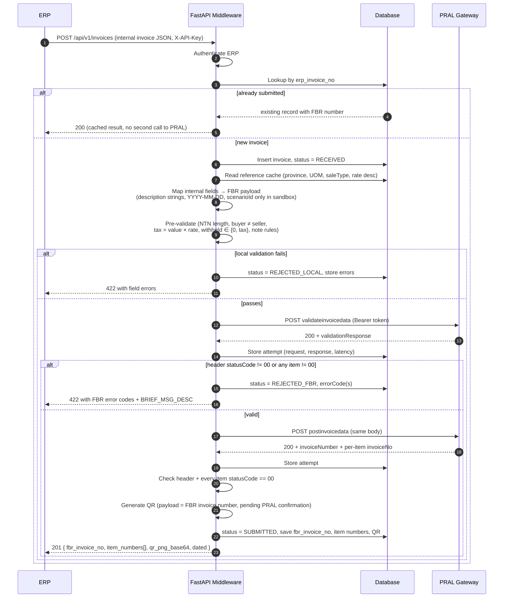
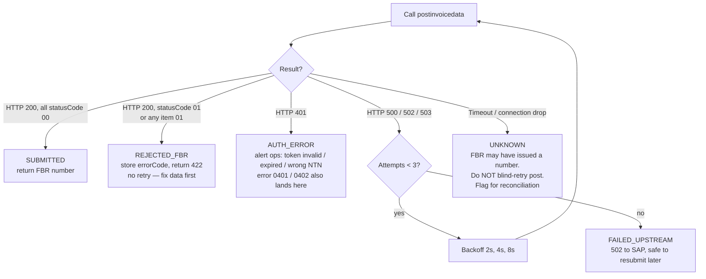
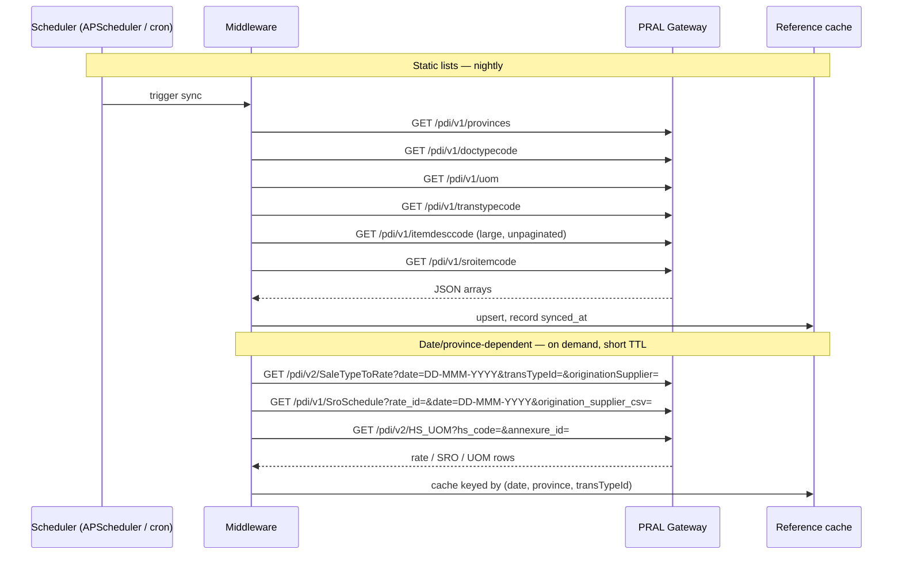
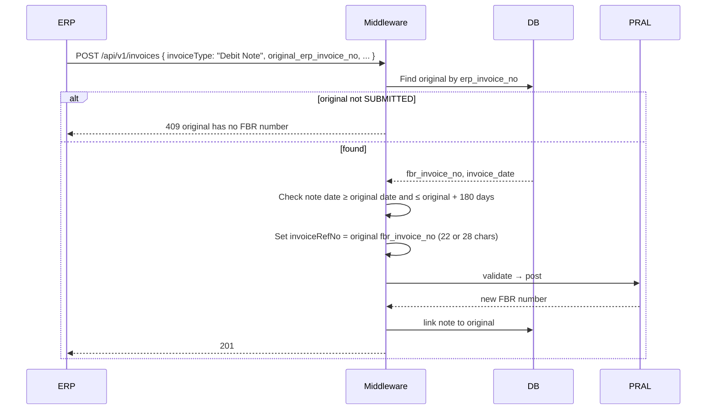
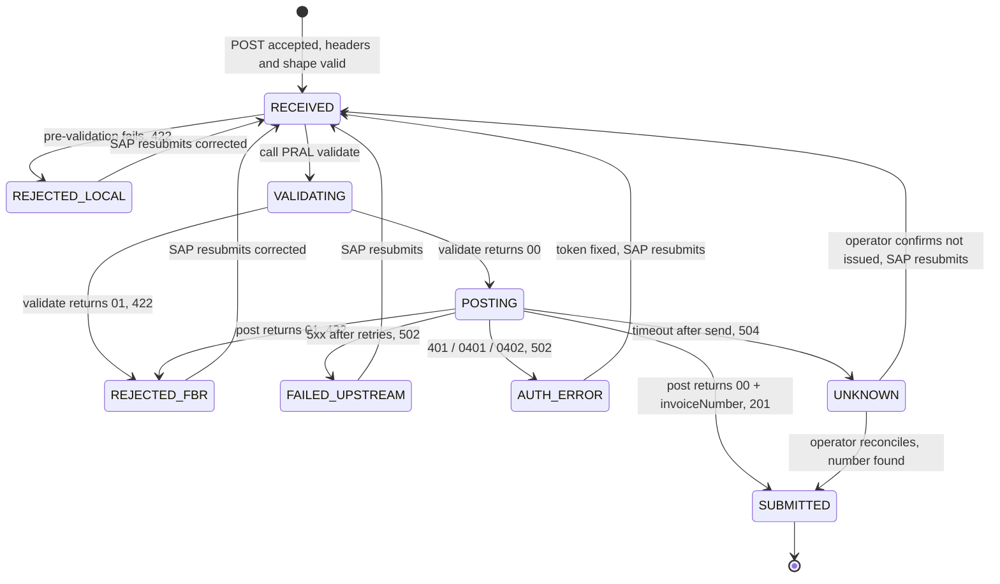
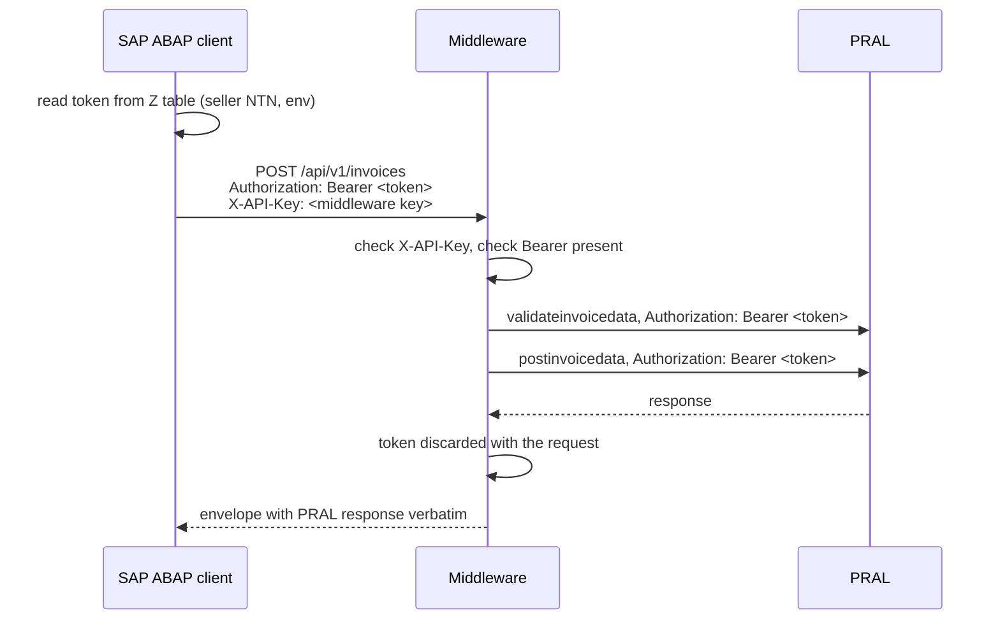

# FBR Digital Invoicing Middleware — Flow (FastAPI)

The middleware sits between the ERP and PRAL's gateway. The ERP never talks to FBR directly. The middleware owns the PRAL token, the reference-data cache, payload mapping, error translation, and the audit trail.

## 0. Integration directions

The middleware is a synchronous pass-through. SAP calls the middleware with the invoice and the PRAL Bearer token, the middleware calls PRAL, and PRAL's answer is returned to SAP in the same HTTP response. There is no queue, no worker, no callback and no OData service required from SAP.

The Python implementation is asynchronous internally (FastAPI `async def`, httpx `AsyncClient`) so one process can hold many concurrent SAP calls open while waiting on PRAL. That is an implementation detail; from SAP's point of view the call is request and response.

| Direction | Transport | Auth | What flows |
|---|---|---|---|
| SAP → Middleware | REST/JSON over HTTPS, SM59 HTTP destination from ABAP | `Authorization: Bearer <PRAL token>` supplied by ABAP from the Z table, plus `X-API-Key` issued by the middleware | Invoice payload in; PRAL's response verbatim, wrapped in a thin envelope, out |
| Middleware → PRAL | HTTPS JSON | the same Bearer token, forwarded untouched | validate, then post |
| SAP → Middleware (optional) | REST GET | `X-API-Key` | Look up the stored result of an earlier submission, e.g. after an ABAP-side timeout |

No OData services are consumed by the middleware.


### Submission contract

SAP sends `POST /api/v1/invoices` with `{ erpInvoiceNo, sellerNtn, callbackRef, invoice }` where `invoice` is the PRAL payload. Within the same request the middleware:

1. Authenticates `X-API-Key` and checks that `Authorization: Bearer` is present and well formed. Either missing → `401`, nothing stored.
2. Validates the JSON shape against the parameter tables. Any violation → `422` with field-level errors, nothing stored.
3. Checks idempotency on `erpInvoiceNo`. If a final result already exists, it is returned again with `200` and `replayed: true`; PRAL is not called a second time.
4. Runs local pre-validation (business rules). Failure → `422` with `localErrors`, stored as `REJECTED_LOCAL`.
5. Calls PRAL `validateinvoicedata`, then `postinvoicedata`, forwarding the Bearer token. Each call is logged as an attempt with the Authorization header stripped.
6. Stores the outcome and returns the envelope below. HTTP status reflects the outcome: `201` SUBMITTED, `422` REJECTED_FBR, `502` FAILED_UPSTREAM or AUTH_ERROR, `504` UNKNOWN.

ABAP must set its HTTP client timeout above the middleware's worst case: PRAL timeout × 2 calls + retries. With the defaults below that is about 100 seconds. A shorter ABAP timeout produces false UNKNOWNs on the SAP side while the middleware actually completed.

### Request parameters: SAP → middleware

`POST /api/v1/invoices` body. The Pydantic models enforce this table; a violation returns `422` before anything is stored.

Envelope:

| Field | Type | Required | Rule |
|---|---|---|---|
| `erpInvoiceNo` | string, 1–50 | required | SAP billing document or internal invoice number. Idempotency key. |
| `sellerNtn` | string | required | 7-digit NTN or 13-digit CNIC. Must equal `invoice.sellerNTNCNIC`. Selects the PRAL token. |
| `callbackRef` | string, ≤100 | optional | Opaque value echoed in the response, for SAP-side correlation (e.g. company code + fiscal year). |
| `invoice` | object | required | The PRAL payload below. |

`invoice` header:

| Field | Type | Required | Rule |
|---|---|---|---|
| `invoiceType` | string | required | `"Sale Invoice"` or `"Debit Note"` |
| `invoiceDate` | string | required | `YYYY-MM-DD`, not in the future |
| `sellerNTNCNIC` | string | required | 7 or 13 digits |
| `sellerBusinessName` | string | required | non-empty |
| `sellerProvince` | string | required | must match a province description from the reference cache |
| `sellerAddress` | string | required | non-empty |
| `buyerRegistrationType` | string | required | `"Registered"` or `"Unregistered"` |
| `buyerNTNCNIC` | string | conditional | required when `buyerRegistrationType` is `Registered`; 7 or 13 digits; must differ from `sellerNTNCNIC`. Optional for `Unregistered`. |
| `buyerBusinessName` | string | required | non-empty |
| `buyerProvince` | string | required | province description |
| `buyerAddress` | string | required | non-empty |
| `invoiceRefNo` | string | conditional | required when `invoiceType` is `Debit Note`: 22 or 28 characters, the original FBR invoice number. Must be empty for `Sale Invoice`. |
| `scenarioId` | string | conditional | `SN001`–`SN028`. Required when `FBR_ENV_SUFFIX` is `_sb`. Stripped from the payload when `FBR_SEND_SCENARIO_ID` is false. |
| `items` | array | required | at least 1 item |

`invoice.items[]`:

| Field | Type | Required | Rule |
|---|---|---|---|
| `hsCode` | string | required | pattern `^\d{4}\.\d{4}$` |
| `productDescription` | string | required | non-empty |
| `rate` | string | required | rate description from reference API 5.8, e.g. `"18%"` |
| `uoM` | string | required | UOM description from reference API 5.6 |
| `saleType` | string | required | transaction type description from reference API 5.5 |
| `quantity` | decimal | required | > 0 |
| `totalValues` | decimal | required | ≥ 0 |
| `valueSalesExcludingST` | decimal | required | ≥ 0 |
| `fixedNotifiedValueOrRetailPrice` | decimal | required | ≥ 0, send `0.00` when not applicable |
| `salesTaxApplicable` | decimal | required | ≥ 0 |
| `salesTaxWithheldAtSource` | decimal | required | ≥ 0, and either `0` or equal to `salesTaxApplicable` |
| `extraTax` | decimal | optional | defaults to `0.00` |
| `furtherTax` | decimal | optional | defaults to `0.00` |
| `fedPayable` | decimal | optional | defaults to `0.00` |
| `discount` | decimal | optional | defaults to `0.00` |
| `sroScheduleNo` | string | optional | defaults to `""`; required by PRAL for SRO-based sale types (error 0077) |
| `sroItemSerialNo` | string | optional | defaults to `""`; required by PRAL for SRO-based sale types (error 0078) |

Decimals are serialised to PRAL with two decimal places (four for `quantity`). Optional fields are always sent with their default rather than omitted, because the PRAL samples include every key.

### Response parameters

Envelope returned by `POST /api/v1/invoices` and by `GET /api/v1/invoices/{erpInvoiceNo}`:

| Field | Type | Present | Notes |
|---|---|---|---|
| `trackingId` | string (UUID) | always | middleware correlation id, also in the `X-Tracking-Id` response header |
| `erpInvoiceNo` | string | always | |
| `sellerNtn` | string | always | |
| `callbackRef` | string or null | always | echoed from the request |
| `status` | string | always | `SUBMITTED`, `REJECTED_LOCAL`, `REJECTED_FBR`, `FAILED_UPSTREAM`, `AUTH_ERROR`, `UNKNOWN` |
| `replayed` | bool | always | true when returned from the idempotency store instead of a fresh PRAL call |
| `fbrInvoiceNo` | string or null | set on `SUBMITTED` | PRAL `invoiceNumber` |
| `dated` | string or null | set when PRAL answered | PRAL `dated` |
| `pralHttpStatus` | int or null | set when PRAL answered | |
| `pralResponse` | object or null | set when PRAL answered | PRAL body verbatim, including `validationResponse.invoiceStatuses[]` with per-item `invoiceNo` and `errorCode` |
| `localErrors` | array | always | `[{ field, code, message }]`, empty unless `REJECTED_LOCAL` |
| `errorDescriptions` | array | always | for each PRAL `errorCode` found, the `BRIEF_MSG_DESC` from spec section 7; empty when none |
| `attempts` | int | always | number of PRAL calls made for this invoice |
| `receivedAt`, `completedAt` | ISO datetime | always | |
| `elapsedMs` | int | always | |

HTTP status by `status`:

| `status` | HTTP | SAP action |
|---|---|---|
| `SUBMITTED` | 201 | store `fbrInvoiceNo` and per-item numbers, release output |
| `REJECTED_LOCAL` | 422 | fix data per `localErrors`, resubmit |
| `REJECTED_FBR` | 422 | fix data per `pralResponse` error codes and `errorDescriptions`, resubmit |
| `FAILED_UPSTREAM` | 502 | PRAL 5xx after retries; safe to resubmit later |
| `AUTH_ERROR` | 502 | PRAL 401 or error 0401/0402; check the token in the Z table, then resubmit |
| `UNKNOWN` | 504 | post request was sent but no answer arrived; PRAL may have issued a number. Do not resubmit automatically. Call `GET /api/v1/invoices/{erpInvoiceNo}` later or reconcile via the taxpayer portal. |

The middleware keeps its own invoice and attempt log for audit, idempotency and reconciling UNKNOWN cases. SAP remains the system of record for the FBR invoice number.

## 1. Components

```mermaid
flowchart LR
    subgraph ERP["ERP / Source System"]
        E1[Invoice posting]
        E2[Status lookup]
    end

    subgraph MW["FastAPI Middleware"]
        direction TB
        A[API layer<br/>/invoices, /invoices/{id}, /reference/*]
        AUTH[ERP auth<br/>API key / mTLS]
        IDEM[Idempotency check<br/>erp_invoice_no]
        MAP[Mapper<br/>internal → FBR JSON]
        PREV[Pre-validation<br/>local business rules]
        CLI[PRAL client<br/>httpx, Bearer token,<br/>timeouts, circuit breaker]
        RESP[Response parser<br/>header + item statusCode]
        QR[QR generator<br/>v2 25x25, 1 inch]
        SCHED[Scheduler<br/>reference sync]
        DB[(DB<br/>invoices, items,<br/>attempts, ref cache)]
    end

    subgraph PRAL["PRAL Gateway gw.fbr.gov.pk"]
        V[POST /di_data/v1/di/validateinvoicedata]
        P[POST /di_data/v1/di/postinvoicedata]
        R[GET /pdi/v1/* and /pdi/v2/*<br/>provinces, uom, transtypecode,<br/>itemdesccode, SaleTypeToRate, SroSchedule ...]
        S[/dist/v1/statl<br/>/dist/v1/Get_Reg_Type]
    end

    E1 -->|POST invoice JSON| A
    E2 -->|GET status| A
    A --> AUTH --> IDEM --> MAP --> PREV --> CLI
    CLI -->|1. validate| V
    CLI -->|2. post| P
    CLI -->|buyer status check| S
    V --> RESP
    P --> RESP
    RESP --> QR
    RESP --> DB
    QR --> DB
    A <--> DB
    MAP <--> DB
    SCHED -->|nightly / on demand| R
    R --> DB
```

## 2. Happy path: ERP posts a sale invoice



## 3. Failure and timeout handling



Rules behind this diagram:

- A validation rejection is a data problem. Retrying the same payload will fail the same way, so the ERP gets a 422 and the invoice stays in REJECTED_FBR until it is corrected and resubmitted.
- A timeout on `postinvoicedata` is the dangerous case. The spec documents no idempotency key and no lookup-by-ERP-number endpoint, so a blind retry can create a duplicate FBR invoice. Park the record as UNKNOWN and reconcile manually or via the taxpayer portal.
- Only 5xx and network errors before the request was sent are safe to retry automatically.
- `validateinvoicedata` is always safe to retry since it creates nothing.

## 4. Reference data sync



The invoice payload needs **description strings** (province, rate, UOM, sale type), not IDs. The mapper reads them from this cache so the strings match PRAL exactly.

## 5. Debit note flow



## 6. Invoice state machine



## 7. Middleware endpoints (ERP-facing)

| Method | Path | Purpose |
|---|---|---|
| POST | `/api/v1/invoices` | Submit sale invoice or debit note. Idempotent on `erp_invoice_no`. |
| GET | `/api/v1/invoices/{erp_invoice_no}` | Status, FBR number, item numbers, errors, QR. |
| POST | `/api/v1/invoices/{erp_invoice_no}/validate` | Dry run against PRAL validate only. |
| GET | `/api/v1/reference/{provinces,uom,sale-types,hs-codes}` | Serve cached lists to the ERP for dropdowns. |
| GET | `/api/v1/reference/rates?date=&sale_type=&province=` | Rate lookup, proxied with cache. |
| GET | `/api/v1/buyers/{ntn}/status` | STATL and registration type check. |
| POST | `/api/v1/admin/reference/sync` | Force a reference sync. |
| GET | `/health` | Liveness plus last successful PRAL call and last sync time. |

## 8. PRAL token handling: supplied by SAP per request

The PRAL Bearer token lives in a custom Z table in SAP. The ABAP client reads it and sends it on every call to the middleware in the `Authorization: Bearer <token>` header. The middleware forwards it to PRAL within the same request and never persists it.



Rules:

- Both headers are required. `X-API-Key` authenticates SAP to the middleware. `Authorization: Bearer` is the PRAL token and is passed through untouched. Missing or malformed → `401` before anything is stored.
- The token exists only in request memory. It is never written to the database, attempt log, logs or error responses. A log filter redacts any `Authorization` value.
- On a `401` from PRAL, or error code `0401` / `0402`, there is nothing to refresh. The result is `AUTH_ERROR` with HTTP 502. Fixing the token is a SAP-side action: update the Z table and resubmit.
- The token selects sandbox or production routing on PRAL's side, together with the `_sb` URL suffix. The middleware instance is configured for one environment; SAP must send the matching token.
- No token cache, no expiry tracking in the middleware. Store `VALID_TO` in the Z table and alert from SAP before the 5-year mark.

SAP side, suggested Z table `ZFBR_TOKEN`:

| Field | Type | Notes |
|---|---|---|
| `SELLER_NTN` | CHAR 13 | key |
| `ENV` | CHAR 4 | key, `SB` or `PROD` |
| `TOKEN` | STRING | the PRAL Bearer token, display-restricted |
| `VALID_TO` | DATS | from PRAL issuance, 5 years |
| `CHANGED_AT`, `CHANGED_BY` | TIMESTAMP, UNAME | audit |

## 9. Configuration

| Setting | Sandbox | Production |
|---|---|---|
| `FBR_BASE_URL` | `https://gw.fbr.gov.pk` | same |
| `FBR_ENV_SUFFIX` | `_sb` | empty |
| `MIDDLEWARE_API_KEYS` | one per SAP system | same |
| `DATABASE_URL` | sqlite dev file | PostgreSQL |
| `FBR_SEND_SCENARIO_ID` | true | false |
| `FBR_TIMEOUT_SECONDS` | 30 | 30 |
| `FBR_MAX_RETRIES_5XX` | 3 | 3 |
| `MAX_INFLIGHT_PER_SELLER` | 1 | 1 (serialises PRAL calls per NTN) |
| `MAX_INFLIGHT_TOTAL` | 20 | 50 |
| `REFERENCE_SYNC_CRON` | daily | daily |

## 10. Deployment on Windows Server

Target: a single Windows Server machine, administered over AnyDesk. No Docker, no Linux. Plain Python, run as a Windows service. The server may have no internet access and no Python, so the release is an offline bundle, and the middleware terminates TLS itself so IIS is not required.

### Layout on the server

```
C:\fbr-middleware\
  app\            git checkout or copied release (src/, pyproject.toml, README.md)
  .venv\          python -m venv, packages installed from pyproject
  data\           fbr.db (SQLite) or nothing if PostgreSQL is used
  logs\           app-YYYY-MM-DD.log, rotated daily, 30 days kept
  .env            settings; readable only by the service account
  nssm.exe        service wrapper
```

### Release bundle (built on the developer machine)

`deploy\build-bundle.ps1` produces `fbr-middleware-<version>.zip` containing:

- `python-3.12.x-amd64.exe`, the official installer, for servers without Python
- `wheelhouse\`, every dependency as a wheel from `pip download --platform win_amd64 --python-version 3.12 --only-binary=:all:`
- `app\`, the source tree
- `nssm.exe`
- `install.ps1`, `update.ps1`, `.env.example`

The bundle is carried to the server over AnyDesk file transfer. Nothing on the server needs internet except outbound HTTPS to `gw.fbr.gov.pk`.

### Install steps (run once, PowerShell as Administrator)

1. Unzip the bundle to `C:\fbr-middleware\release`.
2. Run `.\install.ps1`. It installs Python for all users if `py -3.12` is absent (silent, no Store build), creates `.venv`, installs from `wheelhouse` with `--no-index --find-links`, copies `app`, writes `.env` from the example if none exists, and registers the service. Re-running is safe.
3. Edit `C:\fbr-middleware\.env`.

4. Set `FBR_ENV_SUFFIX`, `MIDDLEWARE_API_KEYS`, `LISTEN_HOST=0.0.0.0`, `LISTEN_PORT=8443`, `SSL_CERTFILE`, `SSL_KEYFILE`, `LOG_DIR=C:\fbr-middleware\logs`, `DATABASE_URL=sqlite+aiosqlite:///C:/fbr-middleware/data/fbr.db`.
5. Restrict permissions: `icacls C:\fbr-middleware\.env /inheritance:r /grant:r "NT SERVICE\FbrMiddleware:R" "Administrators:F"`.
6. The service is registered by `install.ps1`; for reference it runs:

```powershell
.\nssm.exe install FbrMiddleware "C:\fbr-middleware\.venv\Scripts\python.exe" "-m fbr_middleware"
.\nssm.exe set FbrMiddleware AppDirectory C:\fbr-middleware\app
.\nssm.exe set FbrMiddleware AppEnvironmentExtra ENV_FILE=C:\fbr-middleware\.env
.\nssm.exe set FbrMiddleware AppStdout C:\fbr-middleware\logs\service-out.log
.\nssm.exe set FbrMiddleware AppStderr C:\fbr-middleware\logs\service-err.log
.\nssm.exe set FbrMiddleware AppRotateFiles 1
.\nssm.exe set FbrMiddleware Start SERVICE_AUTO_START
.\nssm.exe set FbrMiddleware AppExit Default Restart
.\nssm.exe start FbrMiddleware
```

7. Open the firewall port inbound from the SAP application servers only:

```powershell
New-NetFirewallRule -DisplayName "FBR Middleware" -Direction Inbound -Protocol TCP -LocalPort 8443 -RemoteAddress <SAP app server IPs> -Action Allow
```

8. Verify: `Invoke-RestMethod https://localhost:8443/health -SkipCertificateCheck` and a test POST with the mock PRAL running.

### TLS

The middleware terminates TLS itself: `SSL_CERTFILE` and `SSL_KEYFILE` in `.env`, listening on 8443. No IIS. Certificate renewal is a file swap and a service restart.

Certificate source, in order of preference:

1. A certificate for the server hostname from the company CA, requested through SAP Basis. SAP's SM59 destination trusts it once the CA is in STRUST.
2. For sandbox testing only, a self-signed certificate generated by `deploy\new-selfsigned-cert.ps1`, exported as `.cer` and imported into STRUST on the SAP side.

IIS with ARR as a reverse proxy remains an option if the server team mandates it; then the middleware listens on `127.0.0.1:8080` without TLS and the ARR proxy timeout must be raised to 180 seconds.

The server also needs outbound HTTPS to `gw.fbr.gov.pk`. If the site uses a proxy, set `HTTPS_PROXY` in the service environment; httpx honours it.

### Concurrency on Windows

uvicorn's multi-worker mode relies on process forking semantics that are unreliable on Windows, so the service runs one process. Because every handler is async and the work is network-bound, one process handles tens of concurrent SAP calls. If more is needed, install the service twice on two ports and put IIS ARR or a hardware load balancer in front.

### Database

SQLite is sufficient for a single server and a few thousand invoices per day, since every row is written once. If the server is shared or volumes grow, point `DATABASE_URL` at PostgreSQL for Windows or SQL Server via the `asyncpg` or `aioodbc` driver. Back up `data\fbr.db` with the regular server backup; the file is safe to copy while the service runs only if the backup tool uses VSS.

### Updating a release

Unzip the new bundle to `C:\fbr-middleware\release` and run `.\update.ps1`: stops the service, replaces `app`, reinstalls from the new wheelhouse, starts the service, and calls `/health`. `.env`, `data` and `logs` are untouched.

### Pre-deployment checks on the server

```powershell
python --version; py -0p
Invoke-WebRequest https://pypi.org/simple/pip/ -UseBasicParsing -TimeoutSec 10 | Select-Object StatusCode
Invoke-WebRequest https://gw.fbr.gov.pk -UseBasicParsing -TimeoutSec 10 | Select-Object StatusCode
```

The third is the one that matters: without outbound HTTPS to the FBR gateway nothing works, and only the network team can fix it.

### Operations checklist

- Logs in `C:\fbr-middleware\logs`. Search by `trackingId` to follow one invoice through both PRAL calls.
- `GET /health` reports DB reachability and in-flight count. Point the monitoring tool at it.
- The token never appears in logs or the DB. If a log line ever shows `Authorization`, the redaction filter is broken; treat as an incident.
- Windows Update reboots restart the service automatically. Any SAP call in flight at that moment returns an error to ABAP and must be resubmitted.
- Time sync matters: `dated` values from PRAL and `invoiceDate` validation depend on the server clock being correct.
