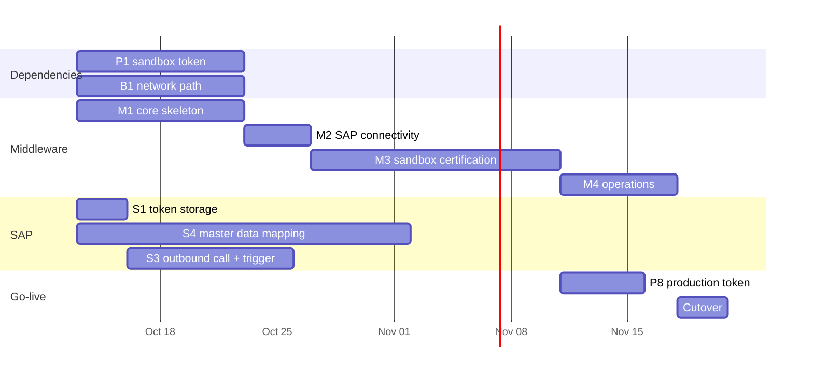

# FBR Digital Invoicing Integration — Work Breakdown

Three workstreams: the Python middleware, the SAP ABAP/OData side, and external dependencies on PRAL and the SAP basis/security teams. Dependencies between streams are marked so the critical path is visible.

Legend: **[M]** middleware team, **[S]** SAP ABAP/OData team, **[P]** needs PRAL, **[B]** needs SAP Basis / security / network.

---

## 1. Middleware (Python / FastAPI)

### Phase M1 — Core skeleton (no external dependencies)

| # | Task | Output |
|---|---|---|
| M1.1 | Project scaffold, config via pydantic-settings, SQLite for dev, PostgreSQL-ready | runnable `uvicorn` app, `/health` |
| M1.2 | Pydantic models for PRAL payload with required/optional/conditional rules from the parameter tables | `models/fbr.py`, unit tests per rule |
| M1.3 | Submission envelope and response envelope models | `models/api.py` |
| M1.4 | DB schema: invoices, attempts; Alembic migrations | `db/` |
| M1.5 | `POST /api/v1/invoices`: API key + Bearer check, pre-validation, idempotency, PRAL validate then post in-request, envelope response | returns 201 / 200 / 422 / 502 / 504 |
| M1.6 | `GET /api/v1/invoices/{erpInvoiceNo}` | result lookup after an ABAP-side timeout |
| M1.7 | Async PRAL client: validate, post, 5xx retry, 401 → AUTH_ERROR, timeout-after-send → UNKNOWN | `clients/pral.py`, respx tests |
| M1.8 | Concurrency control: per-seller-NTN lock so PRAL calls for one NTN are serialised; global in-flight cap | `services/concurrency.py` |
| M1.9 | Mock PRAL server (FastAPI app) returning the spec's sample valid and invalid responses | used by tests and SAP developers before sandbox access |

### Phase M2 — SAP connectivity (needs B1, B3)

| # | Task | Depends on |
|---|---|---|
| M2.1 | Bearer pass-through: require `Authorization: Bearer`, forward to PRAL, never persist, redact from logs | — |
| M2.2 | Secrets handling: API keys from env or vault, never in repo | B3 |
| M2.3 | API key issuance and rotation for SAP callers | B3 |
| M2.4 | Error code catalogue from spec section 7 so the envelope carries `errorDescriptions` | — |

### Phase M3 — PRAL sandbox certification (needs P1–P3)

| # | Task | Depends on |
|---|---|---|
| M3.1 | Reference data sync job: provinces, doctypecode, uom, transtypecode, itemdesccode, sroitemcode | P2 |
| M3.2 | On-demand rate and SRO lookups with date + province cache | P2 |
| M3.3 | Reference endpoints exposed to SAP (`/api/v1/reference/*`) | M3.1 |
| M3.4 | Taxpayer status endpoints (`statl`, `Get_Reg_Type`) | P2 |
| M3.5 | Scenario harness: run every scenario from the business-activity matrix against `_sb` and record results | P1, P3, S5 |
| M3.7 | QR code generation once PRAL confirms the payload | P4 |

### Phase M4 — Operations

| # | Task |
|---|---|
| M4.1 | Admin endpoints: list UNKNOWN invoices, reconcile, force reference sync |
| M4.2 | Structured logging with correlation id = tracking id, Authorization header redaction |
| M4.3 | Metrics: in-flight count, PRAL latency, success/rejection rate per error code, UNKNOWN count |
| M4.4 | Alerting: AUTH_ERROR rate, PRAL 5xx rate, UNKNOWN count > 0 |
| M4.5 | Deployment on Windows Server: venv, NSSM service, IIS ARR reverse proxy with company certificate, firewall rule, .env permissions; see flow doc section 10 |
| M4.6 | Runbook: token rotation, reconciling UNKNOWN, PRAL outage, SAP outage |

---

## 2. SAP ABAP / OData

### Phase S1 — Token storage

| # | Task | Output |
|---|---|---|
| S1.1 | Z table `ZFBR_TOKEN` with keys `SELLER_NTN`, `ENV` (`SB`/`PROD`) and fields `TOKEN`, `VALID_TO`, `CHANGED_AT`, `CHANGED_BY`. Token field excluded from SE16 display authorisation, or stored via SSF encryption. | table + SM30 maintenance view |
| S1.2 | Read routine used by the outbound client (S3.2): pick the token by seller NTN and environment, set `Authorization: Bearer <token>` on the request | included in `ZCL_FBR_INVOICE_CLIENT` |
| S1.3 | Expiry watch: report or job that warns N days before `VALID_TO` so a renewal is requested from PRAL in time | report + job |

### Phase S3 — Outbound call to the middleware

| # | Task | Output |
|---|---|---|
| S3.1 | SM59 HTTP destination type G to the middleware, TLS, `X-API-Key` header; the Bearer header is set per call by the client class, not on the destination (B1, B3) | destination |
| S3.2 | ABAP class `ZCL_FBR_INVOICE_CLIENT`: builds the envelope JSON from the billing document, sets Bearer + API key, calls `POST /api/v1/invoices` with a client timeout ≥ 120 s, handles 201 / 200 / 422 / 502 / 504 / 401, stores FBR number, per-item numbers, status and tracking id | class + unit tests |
| S3.3 | Trigger point: output type / badi on billing document release, or a batch report for backlog; include a manual "send to FBR" transaction for reprocessing | enhancement |
| S3.4 | Result lookup `GET /api/v1/invoices/{erpInvoiceNo}` used when the ABAP call timed out or returned 504, before any resubmit | part of the client class + manual transaction |
| S3.5 | Z link table on the billing document for FBR number, status, tracking id, last error; monitoring transaction listing documents by status with error code and description, re-send | table + report / Fiori list |
| S3.6 | Per-status handling: SUBMITTED → release output with FBR number and QR; REJECTED → block output, show errors; UNKNOWN → hold, lookup before resubmit; AUTH_ERROR → alert token owner | functional spec + code |

### Phase S4 — Master data and field mapping (functional, biggest effort)

| # | Task | Why |
|---|---|---|
| S4.1 | Province mapping: SAP region code → PRAL province description string | `sellerProvince`, `buyerProvince` |
| S4.2 | Customer master: buyer NTN/CNIC field, buyer registration type (Registered/Unregistered), buyer address and province | header fields |
| S4.3 | Company code / plant: seller NTN, business name, address, province | header fields |
| S4.4 | Material master: HS code per material (`^\d{4}\.\d{4}$`), PRAL UOM description per material UoM | `hsCode`, `uoM` |
| S4.5 | Tax mapping: SAP tax code / condition → PRAL `saleType` description and `rate` description string | `saleType`, `rate` |
| S4.6 | Pricing conditions → `valueSalesExcludingST`, `salesTaxApplicable`, `furtherTax`, `extraTax`, `fedPayable`, `discount`, `salesTaxWithheldAtSource`, `totalValues`, `fixedNotifiedValueOrRetailPrice` | item amounts, must satisfy PRAL arithmetic checks |
| S4.7 | SRO schedule and SRO item serial mapping for reduced-rate / exempt sale types | `sroScheduleNo`, `sroItemSerialNo` |
| S4.8 | Debit note: resolve the original billing document's FBR number into `invoiceRefNo`; enforce 180-day window | debit note flow |
| S4.9 | Scenario ID per sandbox test case, driven from the business-activity matrix | sandbox only |

---

## 3. What is needed from PRAL

| # | Item | Blocks | How to obtain |
|---|---|---|---|
| P1 | ERP/integrator registration with FBR Digital Invoicing and **sandbox Bearer token** per seller NTN | M3, S4 testing | IRIS portal, Digital Invoicing registration; PRAL issues the token |
| P2 | Confirmation that the reference APIs (`/pdi/v1`, `/pdi/v2`, `/dist/v1`) work with the same token and whether they are rate-limited | M3.1–M3.4 | PRAL support |
| P3 | The taxpayer's **business activity and sector** as registered in the sales tax profile, to pick the mandatory scenario set | M3.5 | taxpayer's IRIS profile |
| P4 | **QR code payload specification** (spec gives only size and version) | M3.7, invoice print layout | PRAL support, written confirmation |
| P5 | Clarification on **credit notes**: accepted `invoiceType` value, whether reason/remarks fields exist | S4.8, models | PRAL support |
| P6 | Whether `scenarioId` must be omitted or may be empty in production | M1.2 | PRAL support or sandbox test |
| P7 | Buyer NTN length rule (7/9 vs 7/13 digits), `totalValues` definition, and the correct HTTP verb for `statl` and `Get_Reg_Type` | M1.2, M3.4 | PRAL support or sandbox test |
| P8 | Production token after sandbox certification sign-off | go-live | PRAL, after scenarios pass |
| P9 | IP allow-listing requirements, if any, for `gw.fbr.gov.pk` | B1 | PRAL support |
| P10 | Support contact and escalation path for production incidents | runbook | PRAL |

---

## 4. What is needed from SAP Basis / security / network

| # | Item | Blocks |
|---|---|---|
| B1 | Network path: SAP → middleware (inbound to middleware), middleware → `gw.fbr.gov.pk` (outbound internet, TLS). Firewall rules and proxy settings. | M2, S3 |
| B3 | Secret storage for middleware API keys and TLS certificates; rotation policy | M2.2, S3.1 |
| B4 | Windows Server for the middleware with AnyDesk access, local admin for install, Python 3.12 allowed, outbound HTTPS to gw.fbr.gov.pk, inbound port from SAP app servers, certificate from company CA, backups of C:\fbr-middleware\data | M4.5 |
| B5 | Transport route and change process for the Z objects | S1–S4 |
| B6 | Monitoring hooks: where middleware alerts go (email, Teams, SolMan) | M4.4 |

---

## 5. Sequencing and critical path

Dates are placeholders from today; durations are rough effort, not calendar commitments.

Critical path: **P1 sandbox token** and **S4 master data mapping** gate certification. M1, S1 and S3 can start now with no external input. The middleware's mock PRAL server (M1.9) lets SAP developers test S3 before the sandbox token arrives.

---

## 6. Decisions still open

| Decision | Owner | Default if not decided |
|---|---|---|
| One PRAL token for all company codes or one per seller NTN | SAP functional + PRAL | one per NTN |
| Where the FBR number lands in SAP: `VBRK` append field or Z link table | SAP functional | Z link table |
| Trigger: output type on billing release vs batch job | SAP functional | output type, batch as fallback |
| Basic auth vs X.509 for the middleware service user | Basis / security | basic auth over TLS |
| PostgreSQL vs SQL Server for the middleware DB | Basis | PostgreSQL |
| Who reconciles UNKNOWN invoices and how often | operations | middleware admin screen, daily |
